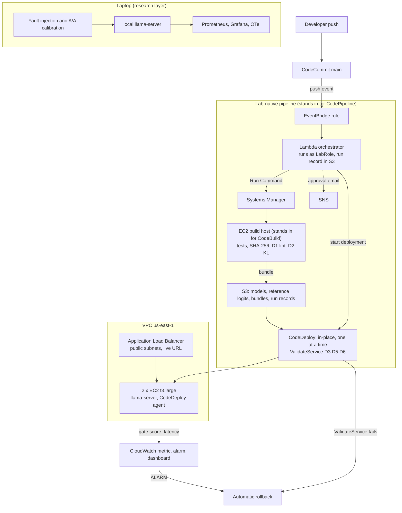

# PRD: DriftGate, a fault-calibrated release gate for self-hosted LLM serving

| Field | Value |
| --- | --- |
| Owner | Sankalp Rajeev |
| Course | ECE 528 Cloud Computing, Final Project, Topic #7 (CI/CD Pipeline for Automated Deployment) |
| Instructor | Professor Furat Al-Obaidy |
| Demo | Wednesday 2 December 2026 |
| Teardown deadline | Thursday 3 December 2026 (within 24 h of demo) |
| Version | 1.2, 18 November 2026 (v1.1 same day; v1.0 approved 9 November 2026) |
| Status | P0 Spec approved; Lab probes done; Lab-native design approved by instructor 18 Nov; agent setup done (T-02); P2 Plan and P3 Build next |
| Process | Agentic SDLC, defined in Section 11 |

### Changes in v1.2

| Area | Change |
| --- | --- |
| Detector data and statistics | New Section 6.2.1 fixes models, download sources, the D2 corpus, the D3 prompt set and metric, the D5 panel, its selection rule and interval method, D6, and the F3 flags |
| Merging | The coding agent squash-merges its own PRs after green CI; the human reviews after merge and merges gated PRs only (Section 11) |
| Task cards | GitHub Issues replace `tasks/T-NN.md` (Sections 11 and 12) |
| Backlog | T-02 is agent setup (done); ADRs move into T-03; T-05 adds D6 measurement; T-11 split into T-11 (local build checks) and T-28 (Lab build host wiring); new T-29 (IAM policy documents) and T-30 (detector data); T-16 becomes F5 evasion plus D6 threshold calibration |
| Open questions | Qwen2.5 licences resolved (Apache-2.0); KV-cache flags named |

### Changes in v1.1

| Area | v1.0 | v1.1 | Why |
| --- | --- | --- | --- |
| Orchestration | CodePipeline V2 | EventBridge rule + Lambda orchestrator | CodePipeline cannot assume LabRole (probe, 17 Nov); instructor approved the stand-in (18 Nov) |
| Artifact gate | CodeBuild | EC2 build host driven by Systems Manager Run Command | CodeBuild returns AccessDeniedException (probe, 17 Nov); instructor approved |
| Source | GitHub, fallback CodeCommit or S3 | CodeCommit (`main`), GitHub as mirror | CodeCommit push to EventBridge to Lambda verified 17 Nov |
| Approval | None | SNS email approval before Deploy | Matches presented architecture |
| Least privilege | Written policies, LabRole deviation | Documentation plus enforcement where possible, implemented under LabRole | Instructor guidance, 18 Nov |
| Observability | Monitoring t3.small in the VPC | Prometheus, Grafana, OTel on the laptop; CloudWatch dashboard in the Lab | Instructor approved laptop for research layer and dashboards; removes one instance and an ingress path |
| Cost evidence | Cost Explorer screenshot | Cost Explorer snapshot before teardown plus Lab spend panel | Cost Explorer lags about a day; instructor approved |
| New deliverable | — | One-page appendix "Lab Constraints and Equivalences" (FR-28) | Instructor request, 18 Nov |
| Schedule | Dates from 9 Nov | Rebased from 18 Nov | Section 12 |
| Budget | About $22 | About $16 | CodeBuild, CodePipeline and the monitoring instance removed |

---

## 1. Summary

DriftGate is a release gate for self-hosted LLM serving on llama.cpp. It answers one operational question: "Did this change to the serving stack change model behavior, and should it ship?"

The project has two layers:

1. **Evidence layer (portable, runs off-AWS on the laptop).** A fault-injection study that measures which detectors catch which serving faults (quantization, KV-cache type, chat template, sampler defaults, context window, engine version, thread count), at what sample budget, false-alarm rate and wall-clock cost. Prometheus, Grafana and OpenTelemetry run here too.
2. **Delivery layer (graded, runs on AWS Academy Learner Lab).** A Lab-native CI/CD pipeline. A push to CodeCommit fires an EventBridge rule that invokes a Lambda orchestrator (standing in for CodePipeline). The orchestrator runs artifact checks on an EC2 build host through Systems Manager (standing in for CodeBuild), asks for approval by SNS email, then starts a CodeDeploy rolling deploy that runs live behavioral checks in the `ValidateService` hook and rolls back automatically on hook failure or on a CloudWatch alarm.

The tool alone would be crowded (infer-check, XLAxiom, quant-regress, vouch, llm-canary, ggufdoctor, LiveNerf all shipped parts of it). The calibrated fault-by-detector evidence plus a deploy-time gate with rollback is the contribution.

---

## 2. Problem and motivation

- Infrastructure and configuration changes degrade LLM output without failing health checks. Anthropic traced weeks of degraded Claude responses in 2025 to three infrastructure bugs, with up to 16% of Sonnet 4 requests affected at peak ([coverage](https://capitalandcompute.net/md/how-to-tell-if-claude-is-nerfed.md)).
- Accuracy can stay flat while individual answers flip; KL divergence and flips track each other under compression ([Dutta et al., NeurIPS 2024](https://arxiv.org/html/2407.09141v1)). Others argue token-level proxies miss task-accuracy collapse ([quant-regress](https://pypi.org/project/quant-regress/)).
- Logprob-based verification is reported to break under production nondeterminism ([Cai et al., 2025](https://arxiv.org/abs/2504.04715v2)). Single-tenant CPU serving controls batch size and threads, so whether that holds there is open.
- Published GGUF files frequently ship chat templates that render a different prompt than the upstream model: 26 of 185 comparable top repositories in one survey, mostly on tool calls ([ggufdoctor](https://pypi.org/project/ggufdoctor/)).

No public source found in this research reports a calibrated fault-by-detector matrix with measured false-alarm rates for non-weight serving faults. Treat that as "not found", not "does not exist".

---

## 3. Goals and non-goals

### Goals

| ID | Goal |
| --- | --- |
| G1 | Pass the ECE 528 rubric at full marks: working CI/CD on AWS, sound architecture and security, strong demo |
| G2 | Produce a calibrated fault-by-detector table with honest null results |
| G3 | Ship a gate that automatically rolls back at least 3 injected faults live in the demo |
| G4 | Close the LLM-serving, AWS and observability gaps on the resume; partially close security and open-source |
| G5 | Keep the core runnable without the Lab (laptop plus GitHub Actions) |

### Non-goals

- A general LLM eval harness, prompt-regression tool or agent framework.
- GPU serving, vLLM, multi-tenant batching.
- Real end users (the Zoetis internship already carries that signal).
- Frontier-model API auditing.
- Production-grade multi-region availability.

---

## 4. Stakeholders

| Stakeholder | Needs from this project |
| --- | --- |
| Course instructor (grader) | Topic #7 visibly core; live URL; diagram; slides with Cost Explorer; least-privilege story; resources terminated on time; technologies disclosed; one-page "Lab Constraints and Equivalences" appendix |
| Hiring reviewer (AI Eng, MLE, FDE) | Evidence of LLM serving depth, AWS delivery, named observability stack, rigor, a clear measured result |
| Persona: platform engineer self-hosting a model | A gate they can drop into a pipeline that blocks a bad quant, template or config before users see it |
| Upstream maintainers (infer-check, ggufdoctor) | Useful issue or PR, not noise |

---

## 5. Research questions

| ID | Question | Why it matters |
| --- | --- | --- |
| RQ1 | Which detectors catch which serving-fault classes at a false-alarm rate of 5% or less, and at what sample budget and wall-clock cost? | Picks the cheapest detector set for the gate |
| RQ2 | On GGUF quantizations of a small instruct model, do KL and top-1 agreement agree with exact-match task accuracy? | Tests Dutta et al. against quant-regress |
| RQ3 | Is greedy logprob output from CPU llama.cpp reproducible across restarts and thread counts? | Tests whether the nondeterminism objection applies to single-tenant CPU serving |

---

## 6. Functional requirements

Every requirement has acceptance criteria (AC) that an automated test or a recorded demo step can check. Task cards in Section 12 reference these IDs.

### 6.1 Serving

| ID | Requirement | Acceptance criteria |
| --- | --- | --- |
| FR-01 | Serve Qwen2.5-1.5B-Instruct Q8_0 GGUF (fallback 0.5B; files and sources in Section 6.2.1) with llama-server under systemd | `/health` returns ok after boot and after instance restart; `--metrics` endpoint returns Prometheus text |
| FR-02 | Pin model artifacts by SHA-256 in a manifest | Build fails if any artifact hash differs from the manifest |
| FR-03 | Serving config (template file, sampler defaults, context, cache type, threads) lives in a versioned config file | Every fault in FR-10 is expressible as a config or artifact diff |

Status: llama-server answers `/v1/chat/completions` locally in WSL (Qwen2.5-0.5B-Instruct Q4_K_M, CPU, smoke test, 17 Nov). FR-01 to FR-03 not yet built.

### 6.2 Detectors

| ID | Detector | Runs in | Acceptance criteria |
| --- | --- | --- | --- |
| FR-04 (D1) | Chat-template lint against upstream via ggufdoctor | Build host | Non-zero exit on F4 and F5 fixtures; zero on reference |
| FR-05 (D2) | Artifact KL and same-top-token rate via `llama-perplexity --kl-divergence` on a fixed small corpus against stored reference logits | Build host | Reports mean KL, 99th percentile KL, same-top-token %; reference vs itself within A/A threshold |
| FR-06 (D3) | Live top-k logprob agreement on greedy continuations via `/completion` with `n_probs` | ValidateService | Reports top-1 agreement and approximate KL over a prompt set; JSON output |
| FR-07 (D4) | MMD two-sample test on sampled completions (Model Equality Testing code) | ValidateService (optional) | p-value and decision at pre-registered alpha |
| FR-08 (D5) | Exact-match panel of "sometimes right" items | ValidateService | Paired per-item delta with interval vs baseline |
| FR-09 (D6) | Latency SLO from llama-server metrics and gate timing | ValidateService and alarm | p95 TTFT and inter-token latency vs baseline budget |

### 6.2.1 Detector data and statistics (decided 18 November 2026)

All data files below are built once by T-30, committed (text only, small), hashed, and frozen by the pre-registration (T-08). Selection uses the reference model only, never a faulted one.

| Item | Decision |
| --- | --- |
| Reference model | `Qwen/Qwen2.5-1.5B-Instruct-GGUF`, file `qwen2.5-1.5b-instruct-q8_0.gguf` (Apache-2.0). F1 uses `qwen2.5-1.5b-instruct-q4_k_m.gguf` and F2 uses `qwen2.5-1.5b-instruct-q2_k.gguf` from the same repo |
| CI and fast-test model | `Qwen/Qwen2.5-0.5B-Instruct-GGUF`, file `qwen2.5-0.5b-instruct-q8_0.gguf` (Apache-2.0). Q8_0 so the CI model follows the same Q8_0 → Q4_K_M → Q2_K ladder |
| Downloads | `https://huggingface.co/<repo>/resolve/<commit>/<file>`, with the repo commit pinned in `serving/models.yaml`; SHA-256 recorded in the manifest at first download (FR-02). Files land in `models/` (gitignored) |
| D2 corpus | The first 2,048 tokens (reference tokenizer) of the WikiText-2 raw test split (CC BY-SA), committed as `gate/data/d2_corpus.txt`. `llama-perplexity -c 512`. Reference logits are produced once with `--kl-divergence-base` on the reference model and stored in `artifacts/reference/` locally and in S3 for the build host; never in git |
| D3 prompt set | 256 instructions from `databricks/databricks-dolly-15k` (CC BY-SA 3.0): records with an empty `context`, instruction length 20 to 300 characters, sampled with seed 0, committed as `gate/data/d3_prompts.jsonl`. Rendered through the serving chat template. Budgets 16, 64 and 256 are the first N records in file order |
| D3 generation and metric | Greedy (temperature 0), 32 new tokens, `n_probs` 10, fixed seed. Per prompt: (a) agreement length, the number of generated tokens identical to the reference before the first difference, as a share of 32; (b) approximate KL(reference ‖ candidate) at each aligned position up to and including the first difference, computed over the union of both top-10 sets with probabilities missing from one side floored at 1e-6 and both sides renormalized. Reported: mean agreement share, mean and 95th-percentile approximate KL |
| D5 panel | MMLU test split (`cais/mmlu`, MIT). Zero-shot prompt ending "Answer with A, B, C or D." A seeded sample of 2,000 questions (seed 0) is scored once on the reference model by the probability of the gold letter among the first generated token's top-10 (absent = 0). "Sometimes right" = gold-letter probability in [0.25, 0.75]. After a seed-0 shuffle, the first 256 such items form the public panel `gate/data/d5_panel.jsonl`; the next up to 512 form the hidden pool `gate/data/d5_hidden_pool.jsonl` for FR-14 |
| D5 scoring and statistics | Exact match of the first generated letter (greedy) against gold. Statistic: paired per-item delta in accuracy (candidate minus reference) on identical items. 95% interval by paired bootstrap (10,000 resamples, seed 0, percentile method); exact McNemar p-value reported alongside. The gate threshold comes from A/A calibration (FR-12), not from the interval |
| D6 | p95 time to first token and p95 inter-token latency over the D3 run, from llama-server response timings. Budget threshold from A/A calibration |
| F3 flags | `--cache-type-k q4_0 --cache-type-v q4_0 --flash-attn on` (V-cache quantization needs flash attention). T-04 confirms these flags in the pinned build's `llama-server --help` and stops if they differ |

### 6.3 Fault injection and calibration

| ID | Requirement | Acceptance criteria |
| --- | --- | --- |
| FR-10 | Fault injector producing A/A and F1 to F9 (table below) as reproducible config or artifact diffs | `make fault F=F4` yields a deployable bundle; diff is logged |
| FR-11 | Pre-registration committed before any fault run | Git commit containing thresholds rule, fault list, analysis script precedes first fault-run commit |
| FR-12 | Threshold calibration from at least 20 A/A runs per detector | Threshold file generated by script; FPR estimate with interval reported |
| FR-13 | Power measurement for every fault at three prompt budgets (16, 64, 256) | Matrix CSV with detection rate, interval, wall-clock per cell |
| FR-14 | F5 evasion test: fixed public panel vs hidden panel sampled per deploy | Detection rate for both reported |

Fault ladder:

| ID | Change | Layer |
| --- | --- | --- |
| A/A | Identical redeploy | None |
| F1 | Weights Q8_0 to Q4_K_M | Artifact |
| F2 | Weights Q8_0 to Q2_K | Artifact |
| F3 | KV cache quantized at launch (flag name verified day 1) | Serving |
| F4 | Chat template edit (system turn or whitespace) | Serving |
| F5 | Tool-call branch of template altered (evasion probe) | Serving |
| F6 | Sampler default changed in launch config | Serving |
| F7 | Context window cut below panel prompt length | Serving |
| F8 | llama.cpp build bump | Engine |
| F9 | Thread count changed | Engine (RQ3 control) |

### 6.4 Pipeline and deployment (course topic #7, Lab-native)

CodePipeline and CodeBuild are unavailable in the Learner Lab (Section 14). The instructor approved the stand-ins below on 18 Nov 2026. CodeDeploy stays as the real managed deploy service.

| ID | Requirement | Acceptance criteria |
| --- | --- | --- |
| FR-15 | Push-triggered pipeline: CodeCommit push to `main` fires an EventBridge rule that invokes the Lambda orchestrator (stands in for CodePipeline). The orchestrator is event-driven: one invocation per stage transition, run state kept as a JSON run record in S3, so no invocation waits on a long stage | A commit to `main` starts a run with no manual steps besides approval; the run record shows every stage with timestamps and outcome |
| FR-16 | Build stage on an EC2 build host via Systems Manager Run Command (stands in for CodeBuild). `deploy/build.sh` runs unit tests, FR-02, D1, D2 and packages the bundle to S3. The SSM command-status event returns control to the orchestrator | Any failure stops the run before approval and Deploy; build log saved to S3 |
| FR-27 | Approval stage: the orchestrator publishes an SNS email with approve and reject links (a Lambda function URL with a one-time token); no response within a set time means reject | Approve starts Deploy; reject or timeout ends the run; decision recorded in the run record |
| FR-17 | CodeDeploy EC2 deployment group, in-place `OneAtATime`, behind an ALB target group, with LabRole as the service role | Instances deregister during deploy and re-register after `ValidateService` |
| FR-18 | `appspec.yml` hooks: `ApplicationStop`, `BeforeInstall`, `AfterInstall`, `ApplicationStart`, `ValidateService` | `ValidateService` runs D3, D5, D6 (and D4 if kept) and exits non-zero on gate failure |
| FR-19 | Automatic rollback on `DEPLOYMENT_FAILURE` and `DEPLOYMENT_STOP_ON_ALARM` with alarms named on the group | Forced hook failure and forced alarm each restore last good revision ([reference](https://stackharbor.com/en/knowledge-base/awsdeploy-rollback-automation-cloudwatch/)) |
| FR-20 | Gate publishes a custom CloudWatch metric (gate score) | Alarm on that metric exists and is attached to the deployment group |
| FR-21 | Per-session CloudFormation stack for VPC, ALB, NAT (or endpoints) | `make up` and `make down` create and delete in one command each |

### 6.5 Observability

Prometheus, Grafana and OpenTelemetry run on the laptop (instructor approved, 18 Nov). In the Lab, CloudWatch carries the gate metric, alarms and a deploy dashboard, so no instance exposes `/metrics` to the internet.

| ID | Requirement | Acceptance criteria |
| --- | --- | --- |
| FR-22 | Prometheus scrapes llama-server `/metrics` in the local stack (fault runs and A/A calibration) | Targets up in Prometheus UI |
| FR-23 | Grafana dashboard: tokens/s, TTFT, queue, gate score per run | Dashboard JSON committed; screenshot in slides |
| FR-24 | OpenTelemetry spans per gate stage (one span per detector) to a local collector | Trace shows D1 to D6 timing for one run; GenAI semconv version pinned and noted as Development status ([status](https://dev.to/mr_manushukla/opentelemetry-genai-conventions-zero-stable-genai-attributes-in-2026-and-what-to-ship-anyway-1l5h)) |
| FR-29 | CloudWatch dashboard in the Lab: gate score, alarm state, ALB target health, deployment status | Dashboard shows a rollback live during the demo |

### 6.6 Portability

| ID | Requirement | Acceptance criteria |
| --- | --- | --- |
| FR-25 | `docker compose up` runs llama-server, gate, Prometheus, Grafana locally | One command on a laptop; README section |
| FR-26 | GitHub Actions job runs the gate against a 0.5B model on every push | Green on reference; red on an injected fault in a test branch |

### 6.7 Course documentation

| ID | Requirement | Acceptance criteria |
| --- | --- | --- |
| FR-28 | One-page appendix "Lab Constraints and Equivalences" in the final submission | One table: constraint, what the Lab does, equivalent used, evidence (probe screenshot or log), what is lost; covers CodePipeline, CodeBuild, IAM role creation and least privilege, research layer on laptop, Cost Explorer lag, session stops |

---

## 7. Non-functional requirements

| ID | Requirement | Target |
| --- | --- | --- |
| NFR-01 | Gate wall-clock per deploy on t3.large | 10 min or less (kill at 15) |
| NFR-02 | A/A false-alarm rate per detector used in the gate | 5% or less |
| NFR-03 | Lab spend | $25 or less, from Cost Explorer snapshot taken before teardown plus Lab spend panel |
| NFR-04 | Network exposure | Only the ALB is internet-facing; no SSH, no key pairs; access via Session Manager; IMDSv2 required |
| NFR-05 | Data at rest | S3 SSE, Block Public Access on all buckets |
| NFR-06 | Least privilege | Documentation plus enforcement where possible, implemented under LabRole (instructor guidance, 18 Nov). Documented: scoped policies per service in `iam/`, validated with IAM Access Analyzer if allowed. Enforced at the resource level: security groups (ALB ingress 80/443 only; serving instances accept only the ALB security group; build host no inbound), SSM instead of SSH, S3 bucket policy (account-only, TLS-only, encryption required), Lambda resource policy limited to the EventBridge rule and the approval URL, IMDSv2. Each control marked "enforced" or "documented only" in the appendix |
| NFR-07 | Reproducibility | Every result row traceable to a commit, config and seed |
| NFR-08 | Region | us-east-1 only |
| NFR-09 | Teardown | All Lab resources terminated by 3 December, with screenshot |

---

## 8. Architecture



Design decisions to record as ADRs (Section 11):

| ADR | Decision | Alternative rejected | Reason |
| --- | --- | --- | --- |
| ADR-001 | llama.cpp on CPU | vLLM on GPU | No GPU in Lab; CPU path is portable |
| ADR-002 | In-place OneAtATime | Blue/green with ASG | Simpler under LabRole; rollback still demonstrable |
| ADR-003 | Two-layer gate (artifact, live) | Live checks only | Artifact faults fail fast and cheaply on the build host |
| ADR-004 | Experiments off-Lab | Run matrix in Lab | Credit budget; Lab session limits; instructor approved |
| ADR-005 | Per-session network stack | Persistent ALB and NAT | Persistent costs about $34 over 3 weeks |
| ADR-006 | Compose existing tools (ggufdoctor, llama-perplexity, MET) | Reimplement detectors | Time; attribution; contribution is calibration |
| ADR-007 (superseded v1.0 "CodePipeline V2") | EventBridge rule plus event-driven Lambda orchestrator | CodePipeline V2 | CodePipeline cannot assume LabRole and role creation is denied; instructor approved 18 Nov |
| ADR-008 | EC2 build host driven by SSM Run Command | CodeBuild | CodeBuild returns AccessDeniedException; SSM needs no SSH or new role; instructor approved 18 Nov |
| ADR-009 | Observability stack on laptop; CloudWatch in Lab | Monitoring t3.small in the VPC | Instructor approved; avoids exposing `/metrics`; one fewer instance |
| ADR-010 | SNS email approval via Lambda function URL with one-time token | No approval; Step Functions | Keeps a human in the loop without a new role; untested in Lab |

---

## 9. Class criteria traceability

### 9.1 Topic and deliverables

| Course requirement | How DriftGate satisfies it | Evidence at demo |
| --- | --- | --- |
| Topic #7: CodeCommit, CodeBuild, CodePipeline, CodeDeploy | CodeCommit and CodeDeploy used as-is; CodePipeline replaced by EventBridge + Lambda orchestrator and CodeBuild by an SSM-driven EC2 build host, both approved by the instructor (18 Nov). The gate is the deploy stage, so the pipeline is the product, not packaging | Live push triggers a full run |
| Pipeline is core to the project | Without the build stage and CodeDeploy hooks there is no gate | Show a fault blocked at Build and another rolled back in Deploy |
| Architecture diagram | Section 8, redrawn for slides | Slide 3 |
| Live URL or API endpoint | ALB DNS serving `/v1/chat/completions` and `/health` | Curl in front of the class |
| Slides: problem statement | Section 2 | Slide 1 |
| Slides: architecture decisions | ADR table | Slide 4 |
| Slides: services used and why | Service table, Section 9.3 | Slide 5 |
| Slides: security configuration | NFR-04 to NFR-06 | Slide 6 |
| Slides: cost analysis from Cost Explorer | Tagged resources; Cost Explorer snapshot before teardown plus Lab spend panel | Slide 7 |
| Slides: challenges and lessons | Lab constraints log, null results | Slide 9 |
| Appendix: Lab Constraints and Equivalences (instructor request) | FR-28 | One page in the submission |

### 9.2 Rubric mapping (100 points)

| Rubric item | Points | What earns it | Requirements |
| --- | --- | --- | --- |
| Functionality and deployment: does it work in the cloud? | 40 | Push to deploy with no manual steps besides approval; live endpoint; 3 faults rolled back or blocked automatically; 1 clean change promoted | FR-15 to FR-21, FR-27, FR-01 |
| Architecture and best practices: security, VPC, IAM least privilege | 20 | Private serving subnets, ALB-only ingress, no SSH, Session Manager, IMDSv2, encrypted private S3, least privilege documented and enforced where possible under LabRole | NFR-04 to NFR-06, FR-21, FR-28 |
| Demo and presentation | 40 | Rehearsed 10-minute script, CloudWatch dashboard live during rollback, cost slide, measured results table | FR-22 to FR-24, FR-29, Section 13 |

### 9.3 Services used and why

| Service | Role | Why this one |
| --- | --- | --- |
| CodeCommit | Source, push trigger | Course topic; push events reach EventBridge (verified) |
| EventBridge | Pipeline trigger | Turns a push into an orchestrator call without CodePipeline |
| Lambda | Pipeline orchestrator | Runs as LabRole (verified); stands in for CodePipeline |
| Systems Manager | Build stage execution, shell access without SSH | Runs the build host stages (verified); removes inbound port 22 |
| EC2 t3.large | Build host and serving | Largest allowed size class; 8 GiB fits a 1.5B Q8_0 model |
| SNS | Approval email | Human approval before deploy |
| CodeDeploy | Rollout and live gate | Course topic; lifecycle hooks host the behavioral check; native rollback |
| ALB | Live URL, health-checked routing | Deregisters instances during deploy |
| CloudWatch | Gate metric, alarms, dashboard | Alarm-driven rollback |
| S3 | Models, reference logits, bundles, run records | Cheap, versioned, encrypted |
| CloudFormation | Per-session network stack | One-command up and down for cost |

### 9.4 Course rules

| Rule | Plan |
| --- | --- |
| AWS Free Tier / Learner Lab credit | Budget about $16 (Section 15); experiments off-Lab |
| Terminate resources within 24 h after demo | `make down` plus manual sweep checklist on 3 Dec; screenshot of empty consoles |
| Individual work | Solo |
| Plagiarism = 0 | All third-party code and tools attributed on a slide and in `ATTRIBUTION.md` |
| Disclose technologies used | Tools listed in the README |
| Custom topic requires approval | Not needed: topic #7 as listed. Lab substitutions approved by Professor Al-Obaidy, 18 Nov 2026 (Section 14.3) |

---

## 10. Resume gap traceability

| Gap (from current resume and GitHub) | Severity | Coverage by DriftGate | Proof a reviewer can check |
| --- | --- | --- | --- |
| LLM serving depth (quantization, KV cache, logprobs, latency) | High | Full | Fault ladder, detector matrix, latency metrics |
| AWS (resume shows AKS and GCP only) | High | Full | CodeCommit, EventBridge, Lambda, Systems Manager, CodeDeploy, EC2, ALB, CloudWatch, S3, SNS, CloudFormation |
| Named observability stack (no OTel, Prometheus, Grafana listed) | Medium | Full | Dashboard JSON, Prometheus config, OTel traces |
| Adversarially tested security work | Medium | Partial | F5 evasion test with measured gap; hashed artifacts; least-privilege policies |
| Merged external open-source contribution | Medium | Partial, not guaranteed | Issue and PR to infer-check (logprob scoring is on its roadmap, [PyPI](https://pypi.org/project/infer-check/)) |
| Agent doing a real job for real users | Low | None by design | Covered by Zoetis internship |
| Pattern risk: third agent verifier | Medium | Reduced | Layer moves from agent tools to model serving and cloud delivery |

Resume entry (replaces Kairos). Brackets are filled only from measured results:

> **DriftGate: Release Gate for Self-Hosted LLM Serving** | Python, llama.cpp, AWS CodeDeploy, Lambda, EventBridge, Systems Manager, CloudWatch, Prometheus, Grafana, OpenTelemetry
> - Built a fault-calibrated release gate for llama.cpp serving: injected [N] serving faults (quantization, KV cache, chat template, sampler, engine) and measured [N] detectors, with thresholds set from [N] A/A runs at [x]% false alarms.
> - Delivered on AWS as an event-driven CI/CD pipeline (EventBridge, Lambda, SSM build host) with CodeDeploy live checks and CloudWatch-alarm rollback on EC2 behind an ALB; [N] of [N] injected faults rolled back automatically, [x] min push-to-decision, $[x] total spend.
> - Found [measured result]; opened [PR] adding logprob scoring to infer-check.

Also: pin DriftGate and ContractRelay on GitHub, unpin Kairos, and update the GitHub bio away from "SLAM, CV, edge AI".

---

## 11. Agentic SDLC

### 11.1 Definition used here

A development lifecycle in which the human owns intent, design decisions and approvals, and AI coding agents implement every coding task against written specs. Every phase ends at a gate with a named artifact; every agent task has machine-checkable acceptance criteria; every change is traceable from requirement to task to commit to test to result.

### 11.2 Phases and gates

| Phase | Output artifact | Gate (who approves, what must be true) |
| --- | --- | --- |
| P0 Spec | This `PRD.md` | Human: goals, FRs, ACs and rubric map accepted |
| P1 Design | `docs/adr/ADR-00N.md`, `docs/architecture.md`, `iam/*.json` | Human: ADRs accepted; Lab probe results recorded |
| P2 Plan | GitHub Issues `T-NN` created with `/to-tickets` (Section 12) | Human: runs `/to-tickets`; each issue has FR link, AC, dependencies, `ready-for-agent` or `ready-for-human` label |
| P3 Build | Code, configs, tests on a branch and PR per issue | Automated: tests, lint and CI pass, then the agent squash-merges; Human: reviews after merge, and merges gated PRs (pre-registration, IAM, anything that touches AWS) |
| P4 Verify | Test reports, A/A calibration, fault matrix | Automated: FR ACs pass; Human: pre-registration respected, results reviewed |
| P5 Release | Pipeline runs, tagged release | Automated: the gate itself (DriftGate gates its own deploys) |
| P6 Operate | Dashboards, alarm history, cost log | Human: daily cost check; rollback drills pass |
| P7 Learn | `docs/retro.md`, slides, write-up, Lab Constraints appendix | Human: null results reported, resume numbers from measured data only |

### 11.3 Repository conventions for agents

```
driftgate/
  AGENTS.md            # context for coding agents: goals, constraints, commands, do-not-touch list
  PRD.md               # this file
  ATTRIBUTION.md       # third-party code and tools
  docs/adr/            # ADR-001..
  docs/prereg/         # pre-registration (committed before fault runs)
  docs/lab-constraints.md  # FR-28 appendix
  gate/                # detectors D1..D6, CLI, JSON verdicts
  faults/              # fault injector and fault definitions
  analysis/            # calibration and matrix scripts, notebooks
  orchestrator/        # Lambda orchestrator and approval handler
  deploy/              # build.sh (SSM build stage), appspec.yml, hooks/, cloudformation/
  observability/       # prometheus.yml, grafana dashboards, otel config, CloudWatch dashboard JSON
  iam/                 # least-privilege policies (documented; enforced where the Lab allows)
  tests/               # unit and acceptance tests keyed by FR id
  .github/workflows/   # portable CI
```

`AGENTS.md` must state: never edit `docs/prereg/` after the pre-registration commit; never change thresholds by hand; never commit credentials; keep detectors deterministic given a seed; run `make test` before proposing a diff; tag every PR with the task card id.

Task cards are GitHub Issues titled `T-NN: <task>` (tracker conventions in `docs/agents/issue-tracker.md`). Issue body template:

```
id: T-NN
requirement: FR-xx
mode: agent | human
inputs: files, data, prior tasks
outputs: files to create or change
acceptance: commands that must pass, expected outputs
out-of-scope: what not to touch
```

Definition of done for any task: AC commands pass in CI, the PR is merged (by the agent, or by the human for gated PRs), no change to pre-registered files.

### 11.4 Division of work

All coding tasks are agent-assisted: detectors, gate CLI, fault injector, analysis scripts, orchestrator Lambda, `build.sh`, `appspec.yml` and hooks, CloudFormation, observability configs, tests and CI.

The human keeps the decisions an agent should not make alone:

| Decision point | Why it stays human |
| --- | --- |
| Approving ADRs and task cards | Sets scope and architecture |
| The pre-registration commit and thresholds rule | Results are only credible if these are fixed before data |
| Merging gated PRs and reviewing the rest after merge | One accountable reviewer; gated changes never merge without the human |
| Running Lab sessions, cost checks and teardown | Spends real credit; irreversible deletions |
| Interpreting results and choosing resume numbers | Claims must match measured data |

---

## 12. Milestones and task backlog

Rebased on Wednesday 18 November 2026. Thanksgiving (26 Nov) is a planned day off. Statuses other than "Done" assume no code exists yet; correct them if a task is further along. If the schedule slips, apply the cut order in Section 17.

| Task | FR | Mode | Due | Phase | Status |
| --- | --- | --- | --- | --- | --- |
| T-01 Lab day-one probes (Section 14) | NFR | Human | 17 Nov | P1 | Done (CodeDeploy with LabRole still open, T-01b) |
| T-01b CodeDeploy probe: app and EC2 group with LabRole as service role, ALB, one alarm | FR-17, FR-19 | Human | 19 Nov | P1 | To do |
| T-02 Agent setup: `AGENTS.md`, skills, permissions, issue tracker | All | Human | 18 Nov | P1 | Done (PR #1) |
| T-03 Repo skeleton, ADR-001 to ADR-010 from Section 8, architecture doc (spec: `docs/agents/T-03.md`) | All | Agent | 19 Nov | P2 | To do |
| T-04 Local llama-server with manifest and hashes | FR-01, FR-02 | Agent | 20 Nov | P3 | Partial (smoke test 17 Nov) |
| T-30 Detector data: D2 corpus, D3 prompts, D5 panel and hidden pool (Section 6.2.1) | FR-05, FR-06, FR-08, FR-14 | Agent | 20 Nov | P3 | To do |
| T-05 Gate CLI with D3, D5 and D6 measurement, JSON verdicts (no thresholds) | FR-06, FR-08, FR-09 | Agent | 21 Nov | P3 | To do |
| T-06 Fault injector F1 to F4, A/A harness | FR-10 | Agent | 21 Nov | P3 | To do |
| T-08 Pre-registration commit (agent drafts, human merges) | FR-11 | Human approves | 22 Nov | P4 | To do |
| T-11 Build checks: `deploy/build.sh` with tests, D1, D2, hashes, runnable locally | FR-02, FR-04, FR-05 | Agent | 23 Nov | P3 | To do |
| T-28 Build host in the Lab: run `build.sh` via SSM, logs and bundle to S3 | FR-16 | Human (Lab) | 25 Nov | P3 | To do |
| T-29 Least-privilege policy documents in `iam/`, one per service, with enforced-or-documented status | NFR-06 | Agent | 24 Nov | P3 | To do |
| T-25 Lambda orchestrator, run record, EventBridge wiring | FR-15 | Agent | 24 Nov | P3 | To do (trigger path verified 17 Nov) |
| T-10 CloudFormation per-session network stack | FR-21 | Agent | 24 Nov | P3 | To do |
| T-12 CodeDeploy appspec and hooks, ALB target group | FR-17, FR-18 | Agent | 25 Nov | P3 | To do |
| T-26 SNS approval with function-URL links | FR-27 | Agent | 25 Nov | P3 | To do |
| T-13 Rollback on hook failure and alarm, gate metric, CloudWatch dashboard | FR-19, FR-20, FR-29 | Agent | 27 Nov | P5 | To do |
| T-07 GitHub Actions job on 0.5B model | FR-26 | Agent | 27 Nov | P3 | To do |
| T-15 Fault matrix F1 to F9, calibration (laptop) | FR-12, FR-13 | Agent | 27 Nov | P4 | To do |
| T-14 Prometheus, Grafana, OTel (laptop) | FR-22 to FR-24 | Agent | 28 Nov | P6 | To do |
| T-16 F5 evasion test (public panel vs hidden pool) and D6 threshold calibration | FR-09, FR-14 | Agent | 28 Nov | P4 | To do |
| T-09 Issue on infer-check | Gap | Human | 28 Nov | P7 | To do |
| T-17 Cost Explorer snapshot | NFR-03 | Human | 29 Nov, refresh 2 Dec before teardown | P6 | To do |
| T-18 Analysis scripts and plots; RQ answers reviewed | RQ1 to RQ3 | Agent, human reviews | 29 Nov | P7 | To do |
| T-27 Lab Constraints and Equivalences appendix | FR-28 | Agent drafts, human approves | 29 Nov | P7 | To do |
| T-20 Slides, diagram, docker compose README | FR-25 | Human | 30 Nov | P7 | To do |
| T-21 Cold-start dry run | All | Human | 30 Nov | P5 | To do |
| T-22 Rehearsal, buffer | All | Human | 1 Dec | P7 | To do |
| T-19 infer-check PR | Gap | Agent, human submits | After demo | P7 | Deferred |
| T-23 Demo | All | Human | 2 Dec | P5 | — |
| T-24 Teardown and proof | NFR-09 | Human | 3 Dec | P6 | — |

---

## 13. Demo script (10 minutes)

1. Problem in one slide (1 min).
2. Architecture and ADRs, including the Lab stand-ins (1.5 min).
3. Live: push a clean change; EventBridge starts the run; build host passes; approve the SNS email; CodeDeploy promotes it; curl the ALB URL (2 min).
4. Live: push F2 (Q2_K); the build host's D2 blocks it before approval (1 min).
5. Live: push F4 (template edit); passes Build, fails ValidateService, rolls back; the CloudWatch dashboard shows it (2 min).
6. Live: force the alarm; deployment stops and rolls back (1 min).
7. Results table (from the laptop research layer, with a Grafana screenshot), null results, cost slide, security slide (1.5 min).

Pre-record steps 3 to 6 as backup video in case the Lab session misbehaves.

---

## 14. Learner Lab constraints and probes

### 14.1 Known constraints

From course materials that quote Lab restriction notes (not AWS docs): us-east-1 and us-west-2 only; EC2 nano to large, 32 vCPU and 9 running instances per region; LabRole and LabInstanceProfile pre-created; 4-hour sessions after which machines stop; spent credit updates every 8 to 12 hours ([Pacific](https://cyberlab.pacific.edu/courses/comp175/resources/aws-academy), [studylib](https://studylib.net/doc/27689384/aws-learner-lab), [CS559](https://www.csd.uoc.gr/~hy559/fall23/CS559-AWS_Tutorial.pdf)).

### 14.2 Probe results

| Probe | Result | Date |
| --- | --- | --- |
| CodeBuild with LabRole | Blocked: AccessDeniedException | 17 Nov |
| CodePipeline V2 with LabRole as service role | Blocked: cannot assume LabRole | 17 Nov |
| IAM role creation | Blocked: denied | 17 Nov |
| CodeCommit repo and commits | Works | 17 Nov |
| CodeCommit push to EventBridge rule to Lambda | Works: event carries repository, branch and commit ID; Lambda invoked within a second | 17 Nov |
| Lambda with LabRole as execution role | Works; writes CloudWatch Logs | 17 Nov |
| EC2 with LabInstanceProfile registers with Systems Manager; Run Command `AWS-RunShellScript` | Works | 17 Nov |
| CodeDeploy console | Opens | 17 Nov |
| CodePipeline console | Opens (pipeline cannot run) | 17 Nov |
| Cost Explorer | Works; per-service data visible, about a day behind | 17 Nov |
| Local llama-server in WSL (Qwen2.5-0.5B Q4_K_M, CPU) | Works; about 90 to 100 tokens/s generation on the laptop | 17 Nov |

Remaining probes:

- [ ] CodeDeploy app and EC2 group with LabRole as service role, ALB, rollback, one alarm (T-01b; highest risk)
- [ ] t3.large with LabInstanceProfile, CodeDeploy agent, reaches S3 and Hugging Face
- [ ] PutMetricData from instance, alarm on it
- [ ] SNS email subscription and Lambda function URL
- [ ] NAT gateway and interface endpoint creation (delete immediately)
- [ ] Session Manager to instance
- [ ] IAM Access Analyzer policy validation
- [ ] Trivial CloudFormation stack create and delete
- [ ] End session, list what still bills

### 14.3 Instructor guidance (Professor Al-Obaidy, email, 18 Nov 2026)

| Question | Answer |
| --- | --- |
| Stand-in for CodePipeline and CodeBuild (EventBridge, Lambda orchestrator, SSM build host) | Acceptable |
| Least privilege with LabRole only | Acceptable by documentation plus enforcement where possible; implemented under LabRole because the Lab blocks new roles |
| Fault injection and Prometheus/Grafana on the laptop | Acceptable |
| Cost analysis with lagging Cost Explorer | Acceptable |
| Additional request | Add a one-page "Lab Constraints and Equivalences" appendix to the final submission (FR-28) |

### 14.4 Risks and fallbacks

| Risk | Fallback |
| --- | --- |
| CodeDeploy refuses LabRole as service role | Email instructor the same day; candidate fallback is a scripted rolling deploy over SSM with ALB deregistration, which drops CodeDeploy and needs approval |
| Lambda function URL or SNS blocked | Approval by a manual "approve" push (tag or file in CodeCommit) |
| Orchestrator Lambda timeout on long stages | Event-driven stages (FR-15); no invocation waits on SSM or CodeDeploy |
| NAT or endpoints blocked | Public subnet, ALB-only security group, Session Manager; documented trade-off |
| ALB and NAT bill between sessions | Per-session CloudFormation stack (ADR-005) |
| Lab session stops instances mid-demo | Start a fresh session before the demo; cold-start dry run (T-21) |
| Cost Explorer lagging | Snapshot before teardown plus Lab spend panel (approved); list-price table as backup |
| Gate too slow | 0.5B model, 16 prompts |
| Least privilege impossible with LabRole | Documented policies plus resource-level enforcement (NFR-06); deviation stated (approved) |

---

## 15. Budget

us-east-1 list prices; whether the Lab bills at list and grants free tier is unverified, so free tier is ignored. Assumes 30 h with serving infrastructure up and 15 h of build host time. Spent so far: $1.04 (17 Nov: CodeCommit $1.00, CloudWatch $0.03, S3 $0.01).

| Item | Assumption | Cost (USD) |
| --- | --- | --- |
| 2 x t3.large serving ($0.0832/h) | 30 h each | 4.99 |
| t3.large build host ($0.0832/h) | 15 h, stopped between runs | 1.25 |
| NAT gateway ($0.045/h + $0.045/GB) | 30 h + 10 GB | 1.80 |
| ALB ($0.0225/h + $0.008/LCU-h) | 30 h | 0.92 |
| Public IPv4 ($0.005/h) | 3 x 30 h | 0.45 |
| EBS gp3 (about $0.08/GB-month, unverified) | 3 x 20 GB, 3 weeks | 3.50 |
| CodeCommit ($1 per active user-month) | November and December | 2.00 |
| Lambda, EventBridge, SNS, SSM | Small, likely under free allowances | under 0.50 |
| S3, CloudWatch (unverified) | Small | under 1.00 |
| **Total** | | **about 16** |

Failure mode: ALB plus NAT left up for three weeks costs about $34 on its own.

Price sources: [t3.large](https://calculator.holori.com/aws/ec2/t3.large), [t3 family](https://www.doit.com/compute/spot/us-east-1/t3.large), [NAT](https://cloudburn.io/tools/aws-nat-gateway-pricing-calculator), [ALB](https://www.opslyft.com/blog/aws-load-balancer-pricing), [IPv4](https://www.usage.ai/?p=457).

---

## 16. Success metrics

| Metric | Target | Still a result if |
| --- | --- | --- |
| A/A false-alarm rate per gate detector | 5% or less from 20+ runs | A detector cannot reach it: reported unusable |
| Fault-by-detector matrix | 7+ faults x 5 detectors x 3 budgets | Some cells are zero |
| RQ2 agreement | Rank correlation KL vs accuracy drop over F1 to F3 | They disagree |
| RQ3 reproducibility | Share of bitwise-identical greedy logprobs | Not identical: floor absorbs it |
| F5 evasion gap | Fixed vs hidden panel detection | Hidden panel does not help |
| Gate wall-clock | 10 min or less | |
| Live rollbacks | 3 faults blocked or rolled back, 1 clean promoted | |
| Lab spend | $25 or less | |
| Upstream | Issue by 28 Nov; PR after demo | Unmerged: reported as open |

---

## 17. Cut order and kill criteria

Cut from the top when behind:

1. D4 (MMD)
2. infer-check PR (keep issue)
3. OTel traces (keep Prometheus, Grafana)
4. Private subnets and NAT
5. Faults F8, F9
6. D2 on the build host (keep live D3)
7. SNS approval (keep push-to-deploy without a manual step)

Never cut: A/A calibration, 3+ faults with automatic rollback, push-triggered pipeline, CodeDeploy with rollback, live URL, Cost Explorer slide, Lab Constraints appendix.

| Trigger | Check by | Action |
| --- | --- | --- |
| CodeDeploy unusable with LabRole | 19 Nov | Email instructor same day with the SSM rolling-deploy fallback |
| No detector reaches 5% A/A at feasible budget | 23 Nov | Make RQ3 the headline null result; gate on D1 and D6 only |
| Gate over 15 min per deploy | 25 Nov | 0.5B model, 16 prompts |
| Spend over $25 | 27 Nov | One instance; no ALB or NAT until demo day |
| Fewer than 3 faults x 3 detectors calibrated | 28 Nov | Freeze scope, write up |

---

## 18. Open questions

- Which Learner Lab variant (Foundational or Associate) the course uses, and its allow-list for CodeDeploy service roles, Lambda function URLs, NAT, Access Analyzer.
- Confirm the KV-cache flags in Section 6.2.1 against the pinned llama.cpp build (T-04).
- Size of stored reference logits for a 2k-token corpus with a ~150k vocabulary (measure on day 2).

---

## 19. Prior art

| Project or paper | Overlap | DriftGate difference |
| --- | --- | --- |
| [infer-check](https://pypi.org/project/infer-check/) | Differential tests across quant, backends (incl. llama-server), concurrency | Adds calibrated FPR, non-weight serving faults, deploy gate; contributes logprob scoring upstream |
| [XLAxiom](https://pypi.org/project/xlaxiom/3.1.0/) | Serving parity, top-1 agreement, KL, CI gate | Fault ladder, power by budget, rollback |
| [quant-regress](https://pypi.org/project/quant-regress/) | Task-accuracy CI gate for quantization | Tests its claim against KL (RQ2) |
| [ggufdoctor](https://pypi.org/project/ggufdoctor/) | Template lint | Used as D1 |
| [LiveNerf](https://capitalandcompute.net/md/how-to-tell-if-claude-is-nerfed.md) | Pre-registration, injected-degradation validation, A/A | Same method applied to self-hosted serving changes |
| [Model Equality Testing](https://arxiv.org/abs/2410.20247?context=cs) | MMD two-sample test | Used as D4 |
| [Dutta et al.](https://arxiv.org/html/2407.09141v1), [Cai et al.](https://arxiv.org/abs/2504.04715v2) | KL and flips; nondeterminism limits | RQ2 and RQ3 test them in this setting |
| [vouch](https://pub.dev/packages/vouch), [llm-canary](https://pypi.org/project/llm-canary/) | Baseline regression gates | Serving layer, not app prompts |
