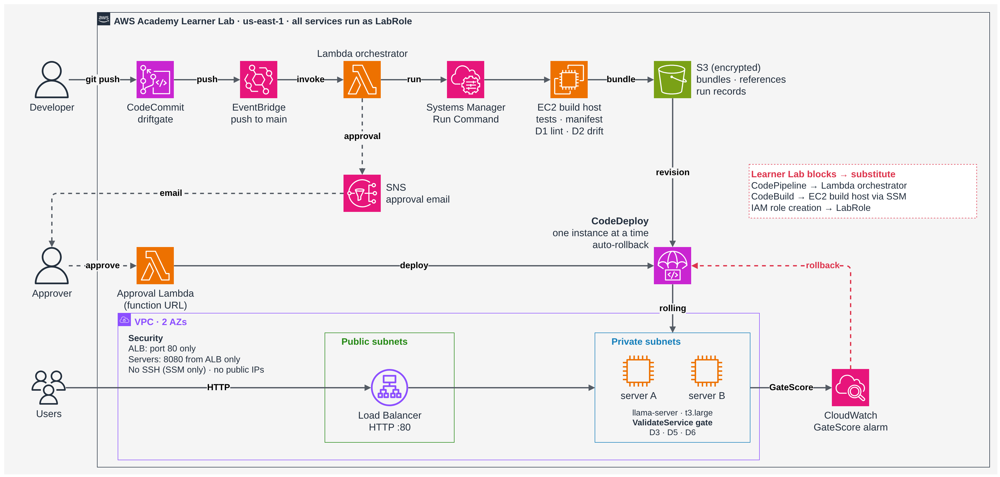

# DriftGate

DriftGate is a release gate for self-hosted LLM serving on llama.cpp. It answers one operational question: "Did this change to the serving stack change model behavior, and should it ship?" It has two layers: an evidence layer on the laptop (fault injection, A/A calibration and a fault-by-detector matrix, with Prometheus, Grafana and OpenTelemetry), and a delivery layer on AWS Academy Learner Lab (CodeCommit push to EventBridge to a Lambda orchestrator, an SSM-driven EC2 build host, SNS approval, and a CodeDeploy rolling deploy whose `ValidateService` hook runs live behavioral checks and rolls back automatically on failure or alarm).

Status: Lab pipeline pending.
The 26 November Learner Lab recording deployed a clean push, blocked F1 at Build with D2,
and triggered automatic rollback when F3 failed ValidateService. F9 passed on t3.large at
one serving thread. The previous rehearsal also verified alarm-triggered rollback.
[Session 4 results](results/2026-11-26-lab-session4/README.md) ·
[Session 3 results](results/2026-11-25-lab-session3/README.md)

## Architecture

## Commands

| Command | What it does |
| --- | --- |
| `make setup` | Create the environment and install dependencies |
| `make test` | Run the test suite |
| `make lint` | Run ruff (lint and format check) |
| `make fmt` | Auto-format |
| `make up` | Create or update the per-session network stack in the Lab (calls AWS) |
| `make serve-baseline` | Restore the demo network, verify the ALB hostname, and redeploy the last successful revision (calls AWS) |
| `make down` | Delete the per-session network stack (calls AWS) |
| `make storage-up` | Create the persistent `driftgate-storage` S3 stack (calls AWS) |
| `make storage-down` | Delete the storage stack at final teardown (calls AWS; empty the bucket first) |

See the [PRD](PRD.md) for requirements, [architecture notes](docs/architecture.md) for the design,
and the [Lab runbook](docs/lab-runbook.md#december-2-demo-startup) for demo startup.
