# Architecture

Source: PRD Section 8 (diagram) and Section 1 (layers).

```mermaid
flowchart TB
  DEV["Developer push"] --> CC["CodeCommit main"]
  CC -->|push event| EB["EventBridge rule"]
  subgraph Orchestration["Lab-native pipeline (stands in for CodePipeline)"]
    EB --> LAM["Lambda orchestrator<br/>runs as LabRole, run record in S3"]
    LAM -->|Run Command| SSM["Systems Manager"]
    SSM --> BH["EC2 build host (stands in for CodeBuild)<br/>tests, SHA-256, D1 lint, D2 KL"]
    BH -->|bundle| S3["S3: models, reference logits, bundles, run records"]
    LAM -->|approval email| SNS["SNS"]
    LAM -->|start deployment| CD["CodeDeploy: in-place, one at a time<br/>ValidateService D3 D5 D6"]
  end
  S3 --> CD
  subgraph VPC["VPC us-east-1"]
    ALB["Application Load Balancer<br/>public subnets, live URL"] --> EC2["2 x EC2 t3.large<br/>llama-server, CodeDeploy agent"]
  end
  CD --> EC2
  CD -->|ValidateService fails| RB["Automatic rollback"]
  EC2 -->|gate score, latency| CW["CloudWatch metric, alarm, dashboard"]
  CW -->|ALARM| RB
  subgraph Laptop["Laptop (research layer)"]
    FI["Fault injection and A/A calibration"] --> LS["local llama-server"]
    LS --> PG["Prometheus, Grafana, OTel"]
  end
```

## Evidence layer (portable, runs off-AWS on the laptop)

A fault-injection study that measures which detectors catch which serving faults (quantization, KV-cache type, chat template, sampler defaults, context window, engine version, thread count), at what sample budget, false-alarm rate and wall-clock cost. Prometheus, Grafana and OpenTelemetry run here too.

## Delivery layer (graded, runs on AWS Academy Learner Lab)

A Lab-native CI/CD pipeline. A push to CodeCommit fires an EventBridge rule that invokes a Lambda orchestrator (standing in for CodePipeline). The orchestrator runs artifact checks on an EC2 build host through Systems Manager (standing in for CodeBuild), asks for approval by SNS email, then starts a CodeDeploy rolling deploy that runs live behavioral checks in the `ValidateService` hook and rolls back automatically on hook failure or on a CloudWatch alarm.

Design decisions are recorded in [`docs/adr/`](adr/).
