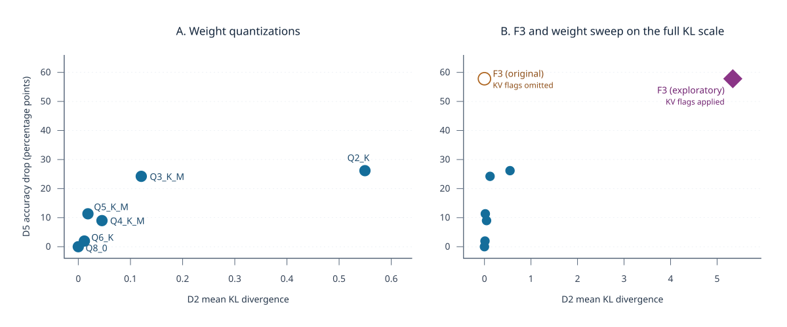

# DriftGate study results

The laptop study completed on 20 November 2026. L1 was the smallest eligible budget
(16 D3 prompts and 64 D5 items). Each fault had two fresh redeploys. The results below
use the saved L1 rows in `runs/2026-11-19-study/matrix.csv`.
The [study archive](../results/2026-11-19-study/README.md) contains the saved matrix,
calibration outputs and analysis summaries.

## L1 detections

| Fault | D1 | D2 | D3 | D5 | D6 | Any detector | Mean D3 time (s) |
| --- | ---: | ---: | ---: | ---: | ---: | ---: | ---: |
| F1 · Q4_K_M weights | 0/2 | 2/2 | 2/2 | 2/2 | 0/2 | 2/2 | 11.79 |
| F2 · Q2_K weights | 0/2 | 2/2 | 2/2 | 2/2 | 0/2 | 2/2 | 9.39 |
| F3 · Quantized KV cache | 0/2 | 0/2† | 2/2 | 2/2 | 0/2 | 2/2 | 15.54 |
| F4 · Default system prompt | 2/2 | — | 2/2 | 2/2 | 0/2 | 2/2 | 13.77 |
| F5 · Tool-call template | 2/2 | — | 0/2 | 0/2 | 0/2 | 2/2 | 14.72 |
| F6 · Sampler default | 0/2 | — | 0/2 | 0/2 | 0/2 | 0/2 | 14.69 |
| F7 · Context window | 0/2 | — | 0/2 | 2/2 | 0/2 | 2/2 | 16.12 |
| F8 · Engine bump to b12557 | 0/2 | 0/2 | 0/2 | 0/2 | 0/2 | 0/2 | 15.85 |
| F9 · One serving thread | 0/2 | — | 0/2 | 0/2 | 2/2 | 2/2 | 53.98 |

Cells show detections / completed runs. A dash means the detector did not run. D4 was cut.
† The original D2 run omitted the F3 KV flags, so this cell provides no evidence about
D2's response to the KV fault. D3 time sums server prompt and generation timings for the
L1 prefix. It averaged 15.28 s across the 30 A/A runs and excludes the rest of the gate.
For a valid 0/2 cell the exact 95% interval is 0–84.19%, and for 2/2 it is 15.81–100%.
Both F7 runs hit HTTP 400 on D5 item 14 (355 tokens for a 256-token context), which
counted as a D5 detection at every budget.

**F8 used [`b12557`](https://github.com/ggml-org/llama.cpp/releases/tag/b12557).**
Both corrected repetitions reported `b12557-b94959a64` from the live server, and
`llama-server --version` confirmed commit `b94959a64`. The baseline reported
`b12491-8c16babba`. No detector fired in either repeat at any budget. The
[F8 run record](results/f8-repair.json) includes the per-run versions, tag date,
and detections. The matrix excludes the downgrade described in the
[tag-selection deviation](deviations/2026-11-20-f8-tag.md).

**Unplanned downgrade observation.** The four-day-older `v1.0.0` build (`b1b770d90`,
13 November) gave bitwise-identical D3 outputs on 128/128 prompts and identical
D5 answers on 512/512 items against the 17 November baseline. Those two runs
are archived as `F8-downgrade-v1.0.0`.

**F6 prediction held.** Changing the default temperature from 0.8 to 1.3 was expected
to have no effect because the gate explicitly requests greedy decoding. Every detector
that ran had 0/2 detections at all three budgets.

**F5's D5 prediction held on both panels.** D1 caught the tools-only template edit in
2/2 runs. D3 and public-panel D5 each detected 0/2 at all budgets. The FR-14 check also
found 0/2 D5 detections on the L1 hidden panels. Both panels used prompts without tools.

| L1 D5 panel | Seed 1 correct (reference → F5) | Seed 2 correct (reference → F5) | Detections |
| --- | ---: | ---: | ---: |
| Public, fixed | 37/64 → 37/64 | 37/64 → 37/64 | 0/2 (0%) |
| Hidden, sampled per run | 39/64 → 39/64 | 38/64 → 38/64 | 0/2 (0%) |

For each run seed, 64 items were sampled without replacement from the frozen hidden pool
in file order using Python's seeded sampler. The reference and F5 each measured the same
sample with greedy decoding and measurement seed 0. All 64 answers matched within each
pair, so both accuracy drops were 0. The saved L1 D5 rule fires only above 0, and the
exact 95% detection interval is 0–84.19% for each panel. The
[hidden-pool run record](results/f5-hidden-pool.json) includes the sampling method,
paired scores and artifact hashes. Raw measurements are under `runs/2026-11-20-t16/`.

## Calibration and reproducibility

The thresholds below are transcribed from the saved calibration output. D1 uses its
pass/fail lint check. D3 is shown in the agreement form used in the threshold file.

| Level | D3 / D5 budget | D2 mean KL, max | D3 mean agreement, min | D5 accuracy drop, max | D6 p95 ITL ratio, max |
| --- | ---: | ---: | ---: | ---: | ---: |
| L1 | 16 / 64 | 0 | 1 | 0 | 1.3720862440822872 |
| L2 | 32 / 128 | 0 | 1 | 0 | 1.1914744913216546 |
| L3 | 64 / 256 | 0 | 1 | 0 | 1.0788455380499387 |

At every level, D1, D2, D3, D5, D6 and the combined gate each had **0/10 held-out false
alarms** (exact 95% Clopper–Pearson CI **0–30.85%** for each). The calibrated rule gives
a per-detector bound of 1/21 (4.76%) for the numeric detectors under exchangeability.
The combined gate has no such bound, and ten held-out trials alone cannot establish a
false-alarm rate below 5%. Source: `runs/2026-11-19-study/calibration/calibration.json`.

For RQ3, every A/A and F9 D3 continuation matched the reference in generated token IDs
and the bit patterns of its stored top-k logprobs. That was 1,280/1,280 prompts across the 20
calibration restarts, 640/640 across the 10 held-out restarts, and 128/128 on the two
F9 runs at one thread. F9 changed latency enough for D6 to detect it at L1.

## RQ2 · Mean KL versus accuracy drop

| Analysis | Spearman ρ | Exact two-sided p | n |
| --- | ---: | ---: | ---: |
| Pre-registered, as recorded (six quantizations and original F3) | 0.32 | 0.47 | 7 |
| Exploratory, six weight quantizations | 0.943 | 0.0167 | 6 |

The pre-registered calculation is reproduced as recorded. Its F3 KL coordinate came
from a run with default cache settings. For the separate **exploratory F3** run with the
KV flags applied, D2 mean KL was **5.337437** and p99 KL was **14.053483**, with **4.804%**
same-top-token agreement. The plot pairs that KL value with the existing F3 D5 drop
of **57.8125 percentage points** on the full 256-item panel. The flagged point is outside
both correlation calculations. See the [deviation](deviations/2026-11-20-d2-kv-flags.md)
and [flagged run record](results/f3-kv.json).

The [plot data](results/rq2-points.csv) come from `rq2-points.json` in the saved study
and the separate flagged run. The published calculation uses the existing exact
permutation analysis in `analysis/rq2.py`. The [run index](results/provenance.csv)
maps each measurement to its config SHA-256, seeds, engine build and artifact SHA-256.
The original checkout commits were reconstructed from run timestamps and local Git
history. The corrected F8 entries cite the implementation commit for the repair.
The Q8_0, Q4_K_M, Q2_K and original F3 points reuse `aa/run-00`, `faults/F1/run-00`,
`faults/F2/run-00` and `faults/F3/run-00` respectively. The other quantizations use the
matching `sweep/<quantization>/run-00` files.

## Post-demo D7 matrix

The [D7 pre-registration](prereg/2026-11-26-d7.md) covers the Ubuntu rerun
`2026-11-26-d7-matrix`. The run writes `runs/2026-11-26-d7-matrix/matrix.csv`.
D7 detection counts, including the F8 result, are pending. The L1 table above
records the 20 November study.
